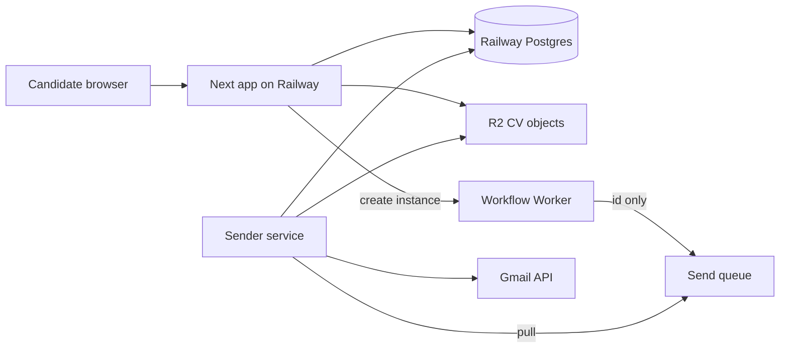
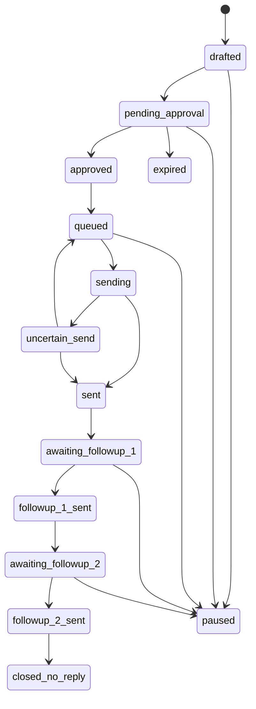
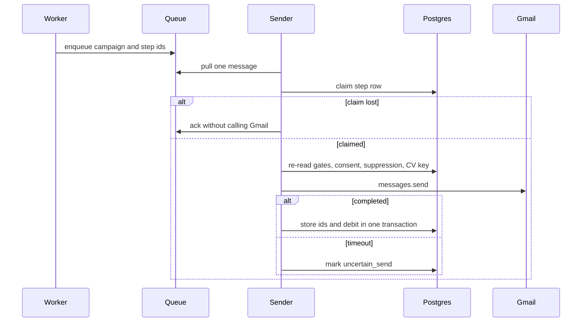

# Firstround Product - Plan

## Goal Capsule

- **Objective:** A candidate in India can get a truthful email to the person who owns a live role, sent from the candidate's own Gmail, and a human reply stops the follow-ups.
- **Means:** Build that on the existing Next.js app, with Review mode as the first shippable cut and Autopilot only after the safety gates (KD1, KTD1).
- **Authority:** `firstround-proprietary-algorithms.md` owns scores, weights, and the learning loop. `firstround-autopilot-architecture.md` owns behaviour, safety, and operations. This plan owns sequencing and the conflict resolutions in Key Decisions. `PRODUCT.md` and `DESIGN.md` own interface language and visual rules.
- **Stop conditions:** No mailbox outside the Google test-user list connects before restricted-scope verification. No inferred address is sent before counsel's written view is stored and the policy flag is on. Autopilot stays off until the go-live gates in the architecture doc pass. An unresolved `uncertain_send` never calls Gmail again.
- **Execution:** code, test-first on the state machine, the outbox, and the sender.
- **Finishes the work:** Implement the units in dependency order. Prajesh accepts each phase exit before the next phase's send behaviour is enabled.

## Product Contract

### Summary

This plan builds the signed-in First Round product and the services behind it. A candidate uploads a CV, connects Gmail, and reviews drafts that have already passed five separate gates. Approved mail leaves from that candidate's Gmail. Follow-ups stop when a person replies. Autopilot, credits, and the evaluation harness are in the same plan and start only after Review mode can prove a safe send.

### Problem Frame

People with a few years of experience apply into a queue and hear nothing. A job board cannot name the person who owns the role. A mail tool that sends without a read cannot protect the candidate's name. The current repo is the public site and Firebase sign-in. It does not store a CV, a job, a draft, or a send.

### Key Decisions

- **Whole product, Review first.** One plan covers foundation through Autopilot and the evaluation harness. Review mode is the first cut that can send. Governs R1 through R12.
- **Readiness gates outreach, not the account.** A score under 85 blocks new campaigns. Supercharge and the checklist stay open at every score. Governs R1.
- **Draft edits are body text.** Approval cannot change the job, the person, or the address. Governs R3.
- **Follow-ups inherit the initial approval.** Business-day 2 and business-day 5 do not ask again. Pause and "I'm hired" cancel every unsent step, including a follow-up already waiting. The candidate can leave `paused` and return to Review. Governs R6.
- **The evening cutoff expires an unapproved draft.** The job lock clears. The job may be chosen again on a later day. Governs R7.
- **Mailbox proof before the recipient page.** The page sends a one-time link to that address, then shows why the person was contacted. The only preference at launch is global permanent removal. Governs R9.
- **Least Gmail access.** The product asks for `gmail.send` and `gmail.readonly`. Drafts stay in First Round. Governs R4.
- **Identity evidence is not an email source.** A permitted profile source may confirm current role and company. Pattern addresses are generated for one chosen person, at most three candidates, at most two verifications, and one send. Governs R2, R4.
- **A Workspace mailbox at the current employer is blocked.** Other Workspace mailboxes warn and need an extra confirm. Personal Gmail is the default. Governs R4.
- **Pilot balance is granted, not charged.** The ledger can debit after a confirmed send before a payment processor exists. Price and expiry stay unset, so credits do not expire. Governs R8.

### Requirements

- R1. A signed-in candidate can upload a PDF or DOCX, see a readiness score with its five parts, accept or reject Supercharge suggestions, and confirm a claim register. New campaigns require readiness of 85 or higher.
- R2. A job is contacted only when job trust, job match, person-job match, address identity, and mailbox confidence each pass their own threshold. The launch thresholds are 75, 78, 80, 75, and 90 on a 0 to 100 scale. A strong gate never repairs a weak one. An invited address printed in the source text replaces the person and address-identity gates and still must pass mailbox confidence.
- R3. Review mode is the default. The candidate approves a draft body in First Round before the first send. The approved hash is the hash that sends.
- R4. The first message leaves from the candidate's own Gmail after a pre-send re-check of liveness, suppression, consent, provenance, token, capacity, and whether the mailbox domain matches the current employer. The product stores Gmail thread id, message id, recipient, and campaign id. It reads message content only for threads it created, and it logs every fetch.
- R5. Every inbound message on those threads is classified before campaign state changes. A human reply, an opt-out, or an uncertain class stops follow-ups. An opt-out or a hard bounce also writes a permanent recipient-key suppression that later campaigns re-read, and that write exists before the first send. An out-of-office with a return date defers. An out-of-office with no date stops.
- R6. Without a stop, follow-up one goes on business day 2 and follow-up two on business day 5, in the recipient's locale, skipping weekends and the configured India holiday list. Both use the same thread, mailbox, and CV version.
- R7. An unapproved draft that reaches the evening cutoff expires. It does not hold the one-active-campaign lock.
- R8. One credit debits if and only if the initial send is confirmed, once. Drafts, skips, failed verification, and follow-ups debit nothing. A hard bounce refunds that debit within 72 hours of the confirmed send.
- R9. Launch recipients are in India. A person can prove the mailbox, see why they were contacted, and remove themselves globally and permanently. A candidate deletion does not globally block those recipients for other candidates. It leaves a candidate-scoped tombstone. The product stores whether an address was published by that person, with the source URL, or inferred.
- R10. Autopilot is off until the candidate turns it on after seeing the rules, with a 15-minute cancel notice. A CV or preference change after the draft was made blocks that send. The product falls back to Review after 7 idle days.
- R11. Each gate stores inputs, score, threshold, algorithm version, and reason. Deterministic rules decide eligibility. A model may rank or draft only inside those rules.
- R12. The interface uses the name First Round, short sentences, the existing sheet and wax styles, and a status sentence. It shows no invented counts, testimonials, or prices.

### Actors

- A1. Candidate. Owns the CV, the Gmail mailbox, approvals, pause, and Autopilot.
- A2. Recipient. A recruiter or hiring manager in India. Can demand removal.
- A3. Operator. Can pause a source, a mailbox, or the platform, with an audited reason. Cannot approve a draft or clear a global suppression.
- A4. Campaign workflow. May pause, add suppression, and enqueue a send id. May not approve, attest a claim, start OAuth, or take payment.

### Key Flows

- F1. Become ready
  - **Trigger:** The candidate uploads a CV.
  - **Actors:** A1
  - **Steps:** Parse, score, Supercharge or checklist, claim confirmation.
  - **Outcome:** An accepted CV version exists. Outreach stays closed until R1.
  - **Covered by:** R1, R11
- F2. Review and send
  - **Trigger:** The daily run finds a job that passes R2.
  - **Actors:** A1, A4
  - **Steps:** Draft, evening approval, pre-send re-check, send, credit debit.
  - **Outcome:** One message in the candidate's Sent mail, or a recorded skip.
  - **Covered by:** R2, R3, R4, R7, R8
- F3. Reply stops the thread
  - **Trigger:** An inbound message matches a stored thread.
  - **Actors:** A2, A4, A1
  - **Steps:** Classify, stop or defer, notify the candidate.
  - **Outcome:** No later follow-up after a human reply or an uncertain class.
  - **Covered by:** R5, R6
- F4. Recipient removal
  - **Trigger:** A person opens the public removal page.
  - **Actors:** A2
  - **Steps:** One-time link to the address, then permanent suppression.
  - **Outcome:** No later campaign can send to that recipient key.
  - **Covered by:** R9

### Acceptance Examples

- AE1. Readiness 84
  - **Covers:** R1
  - **Given:** A parsed CV scores 84.
  - **When:** The daily run starts.
  - **Then:** No campaign is created. Supercharge and the checklist remain available.
- AE2. Independent gates
  - **Covers:** R2
  - **Given:** Job match is 90 and mailbox confidence is 89.
  - **When:** Selection runs.
  - **Then:** The pair is skipped. The skip reason names mailbox confidence.
- AE3. Body-only edit
  - **Covers:** R3
  - **Given:** A pending draft names a verified person.
  - **When:** The candidate changes the body and tries to change the recipient.
  - **Then:** The body can be saved. The recipient, job, and address stay as gated.
- AE4. Ambiguous send
  - **Covers:** R4, R8
  - **Given:** Gmail times out after the send call.
  - **When:** Reconciliation cannot prove the message exists.
  - **Then:** The campaign stays `uncertain_send`. No second send runs. No credit is debited.
- AE5. Pause during a follow-up wait
  - **Covers:** R6
  - **Given:** The initial message is sent and the campaign is `awaiting_followup_1`.
  - **When:** The candidate pauses.
  - **Then:** The follow-up does not send. Resume returns the candidate to Review for later drafts.
- AE6. Cutoff
  - **Covers:** R7
  - **Given:** A draft is still `pending_approval` at the evening cutoff.
  - **When:** The cutoff job runs.
  - **Then:** The campaign becomes `expired` and the job can be selected on a later day.
- AE7. Inferred address held
  - **Covers:** R9
  - **Given:** The address is inferred and counsel has not enabled the policy flag.
  - **When:** The sender claims the step.
  - **Then:** The send is suppressed. A published address with a source URL can still proceed when the other gates pass.
- AE8. Workflow cannot approve
  - **Covers:** R10, R11
  - **Given:** Autopilot is off.
  - **When:** The workflow reaches a `pending_approval` campaign.
  - **Then:** It does not set `approved`. It does not send.

### Success Criteria

- Duplicate initial sends are zero on the property suite and on the pilot.
- The upper 95 percent bound of the high-confidence hard-bounce rate is under 3 percent after at least 300 reviewed sends, before Autopilot can be enabled.
- Unsupported factual claims in sent mail are zero.
- A human reply in the gold set is never classed as out-of-office or auto-acknowledgement.
- The candidate can pause every unsent step from the desk in one action.
- Autopilot stays off in production until a recipient-removal test has passed, along with the bounce bound and the zero-duplicate and zero-unsupported-claim gates.

### Scope Boundaries

In scope: the signed-in desk, CV readiness, the shared India job corpus, the five gates, product-owned drafts, Gmail send and campaign-thread reads, follow-ups, credits, Autopilot behind its gates, recipient removal, and the evaluation harness.

Outside this product's identity: bulk mail, mail sent from a First Round domain as if it were the candidate, guessed-address blasts, auto-submitting employer application forms, and a chat assistant.

#### Deferred to Follow-Up Work

- Learned ranking models. The harness and the rules ship here. Training waits on labels from real sends.
- A second verification vendor, and widening Autopilot until that vendor is in the arbitration rig.
- Payment capture with Razorpay or Stripe. The ledger and a granted pilot balance ship here.
- Partner ATS inbound channels, country packs beyond India, and the public trust-centre metrics that need a quarter of real sends.
- Reviving `hosting/cloudflare-vinext`. The live site is the root Next app on Railway.

### Open Questions

- **Payment processor.** Deferred. The ledger's purchase port stays empty until Prajesh picks Razorpay or Stripe. Pilot sends use a granted balance (R8).
- **Credit price and expiry.** Deferred. Expiry stays off. Price is configuration, not a page claim (R12).
- **India holiday source file.** Deferred to implementation. The calendar is a versioned config list. The owner is operations. The send clock uses that list (R6).
- **KMS vendor.** Resolved during planning. Google Cloud KMS, because the OAuth project already lives in Google Cloud. AWS KMS and Vault remain acceptable swaps behind the same envelope interface (KTD5).

### Sources

- `firstround-autopilot-architecture.md` (v2.0, 8 November 2026), especially sections 2, 4, 12, 14, 19, 21, and Appendix A.
- `firstround-proprietary-algorithms.md` (v2.0), especially sections 1, 3, 4, 5, 6, 7, 9, 12, 13, and 14.
- `PRODUCT.md` and `DESIGN.md` for language and visual rules.
- Repo patterns: `railway.toml`, `app/layout.tsx`, `app/api/waitlist/route.ts`, `lib/firebase.ts`, `components/AuthScreen.tsx`, `app/globals.css`.
- External constraints checked 9 November 2026: Gmail scopes and restricted-scope verification, Workflows limits (365-day sleep, paid step cap, 7-day default history retention), Queues (at-least-once, 24-hour delay, 128 KB body), Drizzle migrations with forced RLS, `firebase-admin` 14 session cookies. DPDP core send duties commence 13 May 2027.

## Planning Contract

### Key Technical Decisions

- KTD1. The Next.js web app stays on Railway as its own service. The sender is a second Railway service with its own variables. Cloudflare Workflows run in a Worker that Railway calls over HTTP, and that Worker only publishes ids. It has no queue consumer binding and no KMS client. Rejected placements: the Next app on a Worker, Gmail calls inside the workflow Worker, and the sender inside the Next process. `hosting/cloudflare-vinext` stays excluded from typecheck. The web host was already settled by `railway.toml`, so the remaining choice was where the token lives, and it lives only on the sender.
- KTD2. The permanent exactly-once key is a Postgres unique pair of campaign and logical step (`initial`, `followup_1`, `followup_2`). The claim predicate is `status = queued`. A dead holder is written to `uncertain_send`, never back to `queued` by lease expiry. An empty Sent search, a Message-ID mismatch, or a 404 stays `uncertain_send`. Return to `queued` happens only in the same transaction as a stored proof that the message is absent. Gmail ids and the `sent` transition commit together. A debit row is inserted only for the initial step. A unique violation is an idempotent no-op. A refund is a second ledger row. The debit row is never deleted to make the refund. Workflow instance ids only block a duplicate start during retention. A client Message-ID and a Gmail draft id are not keys.
- KTD3. Firebase Auth stays the account system. The server session is a cookie checked with `firebase-admin` 14 session-cookie verification, not `verifyIdToken` on that cookie. Gmail OAuth is a second connection. Signup copy stops saying the account address is the mailbox the letters leave from. `signInWithPopup` does not request Gmail scopes.
- KTD4. The sender is the only queue consumer, the only process that decrypts refresh tokens, and the only process that calls Gmail, including watch renewal, history reads, and thread reads. The Next push route checks the Pub/Sub token and stores a notification id. It does not decrypt. The sender stores a Gmail grant only when the OAuth state, the PKCE verifier, and the Firebase uid are the same user. Create-instance takes a short-lived credential bound to that campaign's workspace. Queue and workflow payloads carry ids only. The step after a sleep enqueues an id and the sender re-reads Postgres, including suppression and the employer-domain check from R4.
- KTD5. Schema changes go through Drizzle generate-then-migrate. Row-level security is in those SQL files, forced, and the app connects as a non-owner role. Shared person and address rows are readable only through that candidate's shortlist. Envelope keys live in Google Cloud KMS. The sender alone holds the decrypt principal and the Gmail client secret. The Next app and the Worker hold neither, and no queue body contains ciphertext. AWS KMS and Vault remain swaps behind the same interface.
- KTD6. There is no second tool API, MCP server, or chat send path. Pause and suppression are shared commands used by the candidate, the workflow, and the operator. Approval, claim attestation, Autopilot opt-in, and payment stay human-only.
- KTD7. Domain tests extend the Vitest suite the repo already runs. `npm run ci` already includes format, lint, typecheck, test, `db:ci`, and build. New schema work lands in `db/schema.ts`, which root `drizzle.config.ts` and `npm run db:ci` already apply. The campaign machine to extend is `lib/campaign/`. `apps/api` and `packages/db` are not the Next app's database. Desk screens are checked in a browser on the flows they change. Node stays 22, from `.nvmrc`.

### High-Level Technical Design

The web app, the sender, and the workflow do not share a process. Postgres is the source of truth for campaigns, credits, and audit.



Campaign states and the guards that matter for implementation follow Appendix A of the architecture doc. `paused` is a stop for sends. The candidate can leave it back to Review for new drafts. `uncertain_send` leaves only when reconciliation proves sent or proves not sent.



A send attempt is a claim, a call, and a reconcile. The diagram is the sequence the sender must keep. It is not source code.



### Sequencing

1. U1 through U4 create the desk shell, the session, the database, and the state machine before any provider is called.
2. U5 through U8 create a Review desk that can draft and cannot send.
3. U9 and U10 send and classify inside the test-user list.
4. U11 through U13 add durable timing, credits, and Autopilot behind R10.
5. U14 adds recipient rights and the release gates that Autopilot waits on.

### Assumptions

- The Railway workspace named zeus-pr and the R2 bucket on the omkar Cloudflare account are connected before U5 and U9 run against real services. Local Postgres is enough to build U3 and U4.
- Google restricted-scope verification is a launch gate, not a code gate. Until it finishes, the OAuth client stays in Testing and refresh tokens are treated as 7-day credentials (KTD3, stop conditions).
- Counsel's view on inferred recipient data is required before the policy flag in R9 can be turned on. The flag ships off.

### System-Wide Impact

- `app/layout.tsx` currently mounts the marketing mast on every route, including login. U1 moves that mast to the marketing layout so the desk can have its own chrome.
- `POST /api/waitlist` and `lib/waitlist.ts` stay the public seat list. They are not the campaign store and not a login.
- Firebase Google sign-in and Gmail send authority are different consents. Mixing them would grant mailbox access at account creation.
- A deletion job must remove R2 objects, ciphertext tokens, and draft bodies, and must leave a suppression marker so a late queue delivery cannot send again (R9, KTD2).
- Workflow pauses and suppression writes have to land in `audit_events`. Workflow history expires.
- The daily user cap, the platform recipient cap, and the Gmail mailbox cap are three different counters. The mailbox counter is claimed in the same transaction as the send step.
- The Next process never decrypts a Gmail token. Push handling stores a notification id. Watch, history, and thread reads run on the sender, and they keep only stored thread ids (KTD4, R4).
- Candidate deletion and recipient removal are different writes. Removal is global. Deletion is a candidate-scoped tombstone plus a campaign-step tombstone that a late queue message cannot claim past (R9, KTD2).

### Risks and Dependencies

| Risk | Mitigation |
| --- | --- |
| Restricted Gmail scopes slip past a Testing project and tokens die mid-campaign | Stop the enrollment on `invalid_grant`. One refresh token per mailbox. No public connect button before verification. |
| Ambiguous Gmail timeout causes a second send | KTD2. Property test AE4. |
| Inferred email has no lawful basis | R9 flag default off. Provenance required on the row. |
| App role bypasses row-level security by connecting as owner | KTD5. A test uses the non-owner role and expects a cross-tenant read to return nothing. |
| DPDP duties from 13 May 2027 are missed by a sleeping workflow | KTD4 re-reads the ledger at send time. |
| Naukri or another scraped source is lost or legally disabled | Source register and kill switch in U6. The corpus serves the last good snapshot and shows it as stale. |
| Payment provider choice blocks the pilot | Granted balance in U12. Purchase stays behind an empty port. |
| `gmail.readonly` is mailbox-wide and a history page includes personal mail | The sender discards every id that is not a stored campaign thread before any body fetch (R4, U10). |
| Deletion removes the exactly-once row and a late queue message sends | Tombstones and the debit row are not cascade-deleted. The sender loses the claim when either tombstone is present (U14). |

### Output Structure

```text
app/(marketing)/          public site, login, signup, mast
app/(desk)/               signed-in product chrome and screens
app/api/                  route handlers, session required except waitlist and recipient link
db/                       existing Drizzle schema, client, and migrations
lib/campaign/             existing state machine
lib/domain/               scores and gates
services/sender/          Railway service, token decrypt, Gmail
workers/campaign/         Cloudflare Worker, Workflows, queue publish
```

The tree is the expected shape. Per-unit file lists are authoritative.

## Implementation Units

| U-ID | Title | Primary files | Depends on |
| --- | --- | --- | --- |
| U1 | Desk shell | `app/(desk)/layout.tsx` | none |
| U2 | Server session and workspace | `lib/session.ts`, `app/api/session/route.ts` | U1 |
| U3 | Postgres, RLS, audit | `db/schema.ts` | U2 |
| U4 | State machine and outbox | `lib/campaign/machine.ts` | U3 |
| U5 | CV, readiness, Supercharge | `app/(desk)/cv/page.tsx` | U3 |
| U6 | Job corpus and trust | `lib/domain/jobs.ts` | U3 |
| U7 | Five gates | `lib/domain/gates.ts` | U5, U6 |
| U8 | Review desk | `app/(desk)/today/page.tsx` | U4, U7 |
| U9 | Gmail connection and sender | `services/sender/` | U4, U8 |
| U10 | Replies and classification | `lib/domain/reply.ts` | U9 |
| U11 | Daily run and follow-ups | `workers/campaign/` | U9, U10 |
| U12 | Credits | `lib/domain/credits.ts` | U4, U9 |
| U13 | Autopilot and kill switches | `app/ops/page.tsx` | U11, U12 |
| U14 | Rights, deletion, release gates | `app/remove/page.tsx` | U10, U12 |

### U1. Desk shell and test gate

**Goal:** Give later screens a route group without changing the public page's look. The test runner already exists.

**Requirements:** R12

**Dependencies:** none

**Files:**
- Create: `app/(marketing)/layout.tsx`, `app/(marketing)/page.tsx`, `app/(desk)/layout.tsx`
- Modify: `app/layout.tsx`, `app/login/page.tsx`, `app/signup/page.tsx`
- Test: `app/(desk)/layout.test.tsx`

**Approach:**
1. Move the public page and the mast into the marketing group. Root layout keeps the font and the global stylesheet.
2. Desk layout uses the same CSS variables and does not mount the marketing mast or the 3D scene.
3. Add the desk test to the existing Vitest run. Do not add a second runner.

**Patterns to follow:** `app/globals.css` variables, `components/Mast.tsx` as a server component, `components/Letter.tsx` reduced-motion split.

**Test scenarios:**
- A desk layout render does not include the marketing mast markup.
- The public page still shows the seat form and the skip link.

**Verification:** `npm test` includes the desk layout test. `npm run ci` still passes. The home page and a desk route render as two different chromes in the browser.

### U2. Server session and workspace

**Goal:** A Firebase sign-in becomes a server session tied to one workspace, and protected routes reject a missing or revoked user.

**Requirements:** R1

**Dependencies:** U1

**Files:**
- Create: `lib/session.ts`, `app/api/session/route.ts`, `lib/session.test.ts`
- Modify: `components/AuthScreen.tsx`, `app/(desk)/layout.tsx`
- Test: `lib/session.test.ts`

**Approach:**
1. After client sign-in, exchange the ID token for a session cookie using Admin session-cookie APIs.
2. Desk layout requires that cookie. A failed lookup or a disabled user clears it.
3. Create the user and a personal workspace on first session. Do not treat `intent: "login"` on the waitlist route as an account.
4. Change the signup sentence that equates the account email with the send-from mailbox.

**Patterns to follow:** `lib/firebase.ts` null-when-unconfigured behaviour. `components/AuthScreen.tsx` maps vendor codes to one sentence.

**Test scenarios:**
- A cookie signed for another Firebase project is rejected.
- A disabled user receives no session and the desk redirects to login.
- The first successful session creates one workspace. The second session for the same uid does not create another.
- The waitlist route still accepts a public email and does not create a workspace.

**Verification:** Sign-up, sign-in, sign-out, and a direct visit to a desk URL behave as the scenarios say in the browser. Vendor error codes never appear on screen.

### U3. Postgres, RLS, and audit

**Goal:** Replace the waitlist file as the future store with a tenant-scoped Postgres schema and an append-only audit table.

**Requirements:** R4, R8, R9, R11

**Dependencies:** U2

**Files:**
- Modify: `db/schema.ts`, `db/client.ts`, `db/migrate.ts`
- Test: `db/rls.test.ts`

**Approach:**
1. Extend `db/schema.ts`. It already has workspaces, users, audit events, encrypted tokens, campaigns, transitions, the credit ledger, config, and the source register. Add the missing profile, job, person, and safety tables from architecture section 13. Do not create `lib/db` or point the app at `packages/db`.
2. Generate SQL with Drizzle, then add forced RLS and a non-owner app role in the same journal.
3. Every state-changing helper writes `audit_events` in the same transaction. The payload is ids, an HMAC recipient key, scores, and a reason code. It does not store tokens, draft or reply bodies, CV text, or raw addresses.
4. Leave `lib/waitlist.ts` on the public route.

**Patterns to follow:** Architecture section 13 uniqueness list. KTD5.

**Test scenarios:**
- Two concurrent inserts of the same candidate and canonical job yield one active campaign.
- A query as the app role, with workspace A set, cannot read workspace B.
- Person and address rows outside A's shortlist are not returned, even though the corpus is shared. A client-supplied workspace id does not change the session workspace.
- A query as the owner without forced RLS is not the app's connection. The app role is what the test uses.
- A failed transaction writes no audit row and no campaign row.

**Verification:** Migrations apply on a local Postgres from empty. The RLS test fails if the app connects as the owner.

### U4. State machine and outbox

**Goal:** Illegal campaign transitions are impossible, and a send step can be claimed once.

**Requirements:** R3, R4, R6, R7, R8

**Dependencies:** U3

**Files:**
- Modify: `lib/campaign/machine.ts`, `lib/campaign/transitions.ts`, `lib/campaign/states.ts`
- Test: `lib/campaign/machine.test.ts`

**Approach:**
1. Encode Appendix A states and guards in one module. The database rejects anything else.
2. `pending_approval` to `expired` is the cutoff transition (R7).
3. Any non-terminal state can enter `paused`. Resume does not auto-send. It returns new work to Review (R6).
4. Claiming a step uses one conditional write from `queued`. A dead holder becomes `uncertain_send`. Opt-out and hard-bounce suppression are written by this module before any send exists (R5).

**Execution note:** Implement this module test-first. The property tests are the spec.

**Patterns to follow:** Appendix A invariants. KTD2.

**Test scenarios:**
- A random sequence of illegal edges never lands on `sent` without `approved` or a human Autopilot flag.
- Two overlapping claims of the same campaign and step produce one winner.
- `awaiting_followup_1` plus pause cancels that follow-up. Resume does not make that step sendable. Later drafts go through Review.
- Cutoff moves `pending_approval` to `expired` and clears the active-campaign uniqueness so the job can be chosen again.
- A credit row cannot be inserted unless the campaign is `sent` for the initial step.
- An opt-out suppression row blocks a later campaign to the same recipient key before any Gmail call.

**Verification:** The property suite passes. A direct SQL update that skips a guard fails the check constraint.

### U5. CV, readiness, and Supercharge

**Goal:** The candidate can upload a CV, see a readiness score, and accept an improved version that later sends will use.

**Requirements:** R1, R11, R12

**Dependencies:** U3

**Files:**
- Create: `lib/domain/readiness.ts`, `lib/domain/readiness.test.ts`, `app/(desk)/cv/page.tsx`, `app/(desk)/preferences/page.tsx`, `app/api/cv/route.ts`, `services/parser/`
- Test: `lib/domain/readiness.test.ts`

**Approach:**
1. Accept PDF and DOCX only, with a size and page cap. Store the original and a stripped canonical PDF in R2. Persist the SHA-256 of the attachment bytes.
2. Score evidence completeness, outcome quality, target-role coverage, career consistency, and communication clarity at 20, 25, 25, 15, and 15. Career gaps are not penalties.
3. Supercharge may only use facts from the CV or the candidate's answers. Acceptance writes a new version. The claim register must be confirmed before that version can attach to a campaign.
4. The parser runs as its own Railway process on Node 22, not in the browser and not on a Worker.
5. The preferences page stores work authorization, seniority, and location before any job is gated.

**Patterns to follow:** Status sentence in `components/Letter.tsx`. Algorithm section 1.3.

**Test scenarios:**
- A score of 84 does not open campaign creation. A score of 85 does.
- A suggested bullet that adds a metric the candidate did not supply is rejected by the validator.
- An accepted version is the one later attachment lookup returns. The previous version remains stored.
- A file that is not PDF or DOCX is refused and the API stores nothing in R2.
- Career-gap text does not lower career consistency.

**Verification:** Upload, score, accept, and reject work in the browser with a sample PDF. The object in R2 matches the stored checksum.

### U6. Job corpus and trust

**Goal:** Jobs are collected once per role-location cluster, normalized, and given a trust score before any candidate is matched.

**Requirements:** R2, R11

**Dependencies:** U3

**Files:**
- Create: `lib/domain/jobs.ts`, `lib/domain/jobs.test.ts`, `lib/sources/register.ts`, `lib/sources/apify.ts`
- Test: `lib/domain/jobs.test.ts`

**Approach:**
1. A source cannot be enabled in production without a register row. The Naukri adapter is behind that interface.
2. Normalize to a canonical job. Deduplicate by company, title, and location. Capture an invited address only with a strict parser over the source span.
3. Trust uses the algorithm's rule score. Below 75 the job is quarantined and cannot be shortlisted.
4. A failed run keeps the last corpus and marks it stale. The desk never waits on a scraper.

**Patterns to follow:** Architecture sections 5 and 6. Algorithm section 2.

**Test scenarios:**
- The same posting from two runs becomes one canonical job.
- Trust 74 quarantines the job. Trust 75 with the other fields present can be scored for match later.
- An address written as "name [at] company dot com" becomes one invited channel. Free text a model might invent does not.
- A disabled source produces no new rows and the previous rows stay marked stale.
- A source with no register row cannot be set enabled.

**Verification:** A fixture dataset ingests twice without duplicate canonical jobs. The stale flag is visible on the pipeline screen after U8.

### U7. Five gates

**Goal:** Match, person, and address are separate stored decisions, and selection abstains instead of relaxing a gate.

**Requirements:** R2, R9, R11

**Dependencies:** U5, U6

**Files:**
- Create: `lib/domain/gates.ts`, `lib/domain/gates.test.ts`, `lib/sources/hunter.ts`
- Test: `lib/domain/gates.test.ts`

**Approach:**
1. Hard-filter on work authorization, seniority, and location from preferences before scoring. The preferences screen collects those fields.
2. Save the top 50 matches at or above 78. Score a research set of at most 20 jobs. Contact-research at most 10 of those.
3. Owner and address scores follow the algorithm spec. Verify at most two addresses. `unknown` fails mailbox confidence. `accept_all` fails too, except on the invited-channel path, where the architecture allows it.
4. Store provenance as published-with-URL or inferred. Inferred stays ineligible while the policy flag is off (R9).

**Patterns to follow:** Algorithm sections 3, 4, and 5. Architecture section 1 gate table.

**Test scenarios:**
- Match 90 and mailbox 89 skips with a mailbox reason (AE2).
- An invited address in the source text skips person and address-identity gates and still fails on `unknown`.
- A third verification call for the same job is refused.
- Swapping a name on an otherwise identical profile does not change the score (FairnessGuard allow-list).
- Missing work-authorization on the preference record excludes the job rather than guessing.

**Verification:** A gold fixture of 20 jobs produces the same shortlist on two runs of the same version. Each stored decision has a reason string.

### U8. Review desk

**Goal:** The candidate can read today's drafts, see the evidence, edit the body, and approve before the cutoff.

**Requirements:** R3, R7, R11, R12

**Dependencies:** U4, U7

**Files:**
- Create: `app/(desk)/today/page.tsx`, `app/(desk)/pipeline/page.tsx`, `app/(desk)/campaigns/page.tsx`, `lib/domain/draft.ts`, `lib/domain/draft.test.ts`
- Test: `lib/domain/draft.test.ts`

**Approach:**
1. Today shows drafts, the cutoff, and the credit impact of an approval. Pipeline shows the 50 with scores and skip reasons.
2. DraftGuard compiles only from stored evidence. Specificity below 85 blocks approval.
3. The editor writes body text. Job, person, and address fields are not inputs (AE3).
4. Approval stores the body hash and moves the campaign to `approved`. The cutoff job expires anything still pending.

**Patterns to follow:** `components/Letter.tsx` status sentence. Wax button for the single primary action. No status pills.

**Test scenarios:**
- Saving a body that names a company absent from the evidence is rejected.
- Changing the recipient in the request body is ignored and the stored person stays.
- Approval then a second approval does not create a second initial step.
- A draft still pending at the cutoff becomes `expired` (AE6).
- A campaign view shows the gate reasons, the verification outcome, and the CV version id.

**Verification:** In the browser, a candidate can approve one draft, be blocked on a low-specificity draft, and see an expired draft after the cutoff is forced in a test clock.

### U9. Gmail connection and sender

**Goal:** An approved campaign sends once from the candidate's Gmail, or it stops in `uncertain_send` with no debit.

**Requirements:** R4, R8

**Dependencies:** U4, U8

**Files:**
- Create: `services/sender/`, `app/api/gmail/start/route.ts`, `app/api/gmail/callback/route.ts`, `lib/domain/send.test.ts`
- Create: `app/(desk)/settings/page.tsx`
- Test: `lib/domain/send.test.ts`

**Approach:**
1. OAuth uses state, nonce, and PKCE. The callback checks the Firebase session, then the sender exchanges the code. Missing either Gmail scope stores nothing.
2. Block a mailbox whose domain matches the current employer. Warn on other Workspace domains and require an extra confirm.
3. The sender pulls the queue, claims the step, re-reads eligibility, and calls `messages.send` with one To and no Cc or Bcc.
4. On timeout, mark `uncertain_send`. An empty Sent search stays there (KTD2). Reconciliation moves to `sent` only when the stored thread is found. One claim makes one Gmail call.
5. Store Gmail ids and the `sent` transition together. Insert a debit only for the initial step. A unique violation commits nothing new.

**Execution note:** Implement the claim and the timeout path test-first, against a fake Gmail port.

**Patterns to follow:** KTD2, KTD3, KTD4. Architecture section 21.2.

**Test scenarios:**
- Two overlapping pulls send once (AE4's sibling for the success path).
- A dropped response leaves `uncertain_send`, sends no second message, and debits nothing.
- Reconciliation that finds the message moves to `sent` and debits once.
- A token response missing `gmail.readonly` stores no ciphertext.
- A mailbox at the current employer domain never reaches the sender, including when the employer domain is added after connect.
- OAuth state for user A plus a session for user B stores nothing.
- Workspace A's create-instance credential does not enqueue workspace B's campaign.
- Killing the sender after Gmail accepts and before the status write causes a redelivery that calls Gmail zero more times.

**Verification:** A test mailbox in the Google test-user list receives one message. Logs contain no token, no body, and no authorization code. The Next process has no decrypt key in its environment.

### U10. Replies and classification

**Goal:** Inbound mail on First Round threads is classified, and a human or uncertain message stops follow-ups.

**Requirements:** R4, R5

**Dependencies:** U9

**Files:**
- Create: `lib/domain/reply.ts`, `lib/domain/reply.test.ts`, `app/api/gmail/push/route.ts`
- Test: `lib/domain/reply.test.ts`

**Approach:**
1. The sender renews `users.watch` on a daily cron. Alert when a watch is older than 48 hours. The Next route only verifies the Pub/Sub token and stores a notification id (KTD4).
2. The sender runs `history.list` from the stored history id and keeps only ids that match stored threads. On 404, fetch metadata only for those threads. Do not list the mailbox. Advance history id only after the page is classified or discarded.
3. Rules classify bounces and auto-submitted mail first. Remaining text uses the rules-first classifier. Low confidence is treated as human and stops.
4. A safety-net sweep calls `threads.get` only for campaigns still awaiting a reply.

**Patterns to follow:** Algorithm section 13. Architecture section 4.3.

**Test scenarios:**
- A gold human reply is never labeled out-of-office or auto-acknowledgement.
- An uncertain class moves the campaign to a stop and creates a notification.
- A push with a bad JWT is rejected and does not advance history id.
- A duplicate history id does not apply twice.
- A 404 reads stored threads at metadata and does not call a full mailbox list.
- A history page that mixes one stored thread with one unrelated message persists and logs only the stored thread.

**Verification:** A reply on a test thread stops the campaign and shows on the inbox screen within the safety-net interval. The fetch log names the campaign id and the reason.

### U11. Daily run and follow-ups

**Goal:** Each candidate has one daily run, and follow-ups fire on the business-day schedule without a second approval.

**Requirements:** R6, R10

**Dependencies:** U9, U10

**Files:**
- Create: `workers/campaign/`, `lib/domain/schedule.ts`, `lib/domain/schedule.test.ts`
- Test: `lib/domain/schedule.test.ts`

**Approach:**
1. A cron in the Next app starts the fan-out. The daily run key is candidate plus local date. The Next app reads Postgres, computes the wake time from the recipient locale and the holiday list, and creates the workflow instance with the campaign id, the step, and that wake time.
2. The Worker sleeps until that wake time, then enqueues those ids. It does not open Postgres or Gmail.
3. Follow-ups require the same approval hash, CV version, and mailbox as the initial send.
4. Create the workflow instance with a stable id. An already-exists response during retention is the original run, not a second campaign.

**Patterns to follow:** KTD1, KTD4. Architecture section 14.

**Test scenarios:**
- Two crons on the same local date create one run.
- A sleep that wakes after pause or suppression enqueues nothing that the sender will send. The sender's re-check is what refuses.
- Business day 2 skips a configured holiday and a weekend.
- A retried enqueue still yields one follow-up step.
- Creating the same instance id twice during retention does not create two sends.

**Verification:** A shortened test clock sends follow-up one only when no reply exists. The workflow payload fixture contains ids and no MIME.

### U12. Credits

**Goal:** The ledger debits once on a confirmed initial send, refunds a hard bounce inside 72 hours, and can run a pilot without a payment processor.

**Requirements:** R8, R12

**Dependencies:** U4, U9

**Files:**
- Create: `lib/domain/credits.ts`, `lib/domain/credits.test.ts`, `app/(desk)/credits/page.tsx`
- Test: `lib/domain/credits.test.ts`

**Approach:**
1. An operator principal, which a candidate session cannot satisfy, grants a pilot balance. The purchase function is an interface with no provider. The grant route is not on the candidate desk.
2. The initial confirmation inserts one append-only debit. A follow-up confirmation does not insert another. A replay is a no-op (KTD2).
3. A hard bounce within 72 hours writes a separate refund row. The debit row stays. Later bounces do not refund.
4. The page shows the ledger in sentences. It shows no price.

**Patterns to follow:** Architecture section 11. KTD2.

**Test scenarios:**
- Confirmation inserts one debit. A replay inserts nothing.
- A bounce at 71 hours adds one refund row and leaves the debit. A replay of confirmation after that refund still shows one debit and one refund. A bounce at 73 hours does not refund.
- A failed verification debits nothing.
- A zero balance blocks the claim before Gmail is called.
- The credits page renders amounts from the ledger and no currency slogan.

**Verification:** The pilot grant, one send, and one refund are visible in the desk and match the ledger rows.

### U13. Autopilot and kill switches

**Goal:** Autopilot can send only after the human opt-in, the cancel window, and the go-live gates. Operators can stop mail without approving it.

**Requirements:** R6, R10

**Dependencies:** U11, U12

**Files:**
- Create: `lib/domain/autopilot.ts`, `lib/domain/autopilot.test.ts`, `app/ops/page.tsx`
- Modify: `app/(desk)/settings/page.tsx`
- Test: `lib/domain/autopilot.test.ts`

**Approach:**
1. Opt-in requires a fresh sign-in and a screen that states the rules. The workflow cannot set the flag.
2. The cancel notice defaults to 15 minutes. CV or preference edits after draft generation block that send.
3. Idle 7 days returns the candidate to Review.
4. Operator kill switches live on `app/ops`, behind an operator principal. They pause a mailbox, a source, or the platform and write an audit reason. A candidate session can pause only that candidate. Kill switches do not clear suppression and do not send.

**Patterns to follow:** KTD6. Architecture sections 21.12 and 21.17.

**Test scenarios:**
- With the flag off, a fully gated draft stays `pending_approval` (AE8).
- With the flag on, the send waits out the cancel window and then queues.
- A preference edit during the window blocks the send.
- A platform kill switch pauses queued and awaiting-follow-up campaigns and leaves approval rows intact.
- The workflow calling the opt-in function is rejected.
- A candidate session that calls the operator pause route is rejected. That candidate can still pause their own campaigns.

**Verification:** In the browser, opt-in, cancel, and an operator pause each produce the state the tests name. The release contains no MCP route and no chat send path.

### U14. Rights, deletion, and release gates

**Goal:** A recipient can remove themselves, a candidate can export and delete, and Autopilot cannot be enabled until the measured gates pass.

**Requirements:** R5, R9, R10

**Dependencies:** U10, U12

**Files:**
- Create: `app/remove/page.tsx`, `lib/domain/privacy.ts`, `lib/domain/privacy.test.ts`, `lib/domain/eval.ts`, `lib/domain/eval.test.ts`
- Test: `lib/domain/privacy.test.ts`, `lib/domain/eval.test.ts`

**Approach:**
1. The public page returns the same response for a known and an unknown address. It sends at most one link, only for a stored recipient key, with no candidate, job, or reason in that message. The link opens a short-lived proof session and shows the reason. Global suppression is a separate confirmation. A reused or expired link does neither (R9).
2. Deletion revokes the Google refresh token and stops the watch before discarding ciphertext. It writes a candidate-scoped tombstone and a non-claimable campaign-step tombstone in the same transaction, then removes CV objects, tokens, and draft bodies. The debit row and the tombstones are not cascade-deleted.
3. The gold set and the fairness name-swap suite are release checks. A failed name-swap blocks the release.
4. The Autopilot flag cannot be turned on in production until the bounce bound, zero duplicate sends, zero unsupported claims, and a passed removal test are recorded.

**Patterns to follow:** Algorithm sections 9 and 14. Architecture section 16.1.

**Test scenarios:**
- A known address and an unknown address get the same response. Opening the link shows the reason and does not suppress. A separate confirmation suppresses. A reused or expired link does neither.
- A completed recipient removal suppresses a later claim for that recipient key for every candidate.
- After candidate deletion, the same queue message calls Gmail zero times, the debit count is unchanged, and a snapshot has no raw recipient, reply body, token, or CV bytes. Other candidates can still contact that recipient.
- A gold human reply labeled as auto fails the release check.
- A name swap that changes a shortlist fails the release check.

**Verification:** The remove page works without an account. A deletion job records completion. The eval command fails the build when a fixture violates the gold set.

## Verification Contract

- `npm test` runs the existing Vitest suite, including the campaign property suite, the send claim suite, the reply gold set, and the RLS suite.
- `npm run ci` remains format, lint, typecheck, test, `db:ci`, and production build. It must pass before a unit is done.
- Desk flows U2, U5, U8, U9, U12, and U13 are exercised in the browser: sign-in, upload, approve, pause, and the credits ledger. A screenshot of a single screen is not enough.
- The sender's environment is checked by absence: the Next service has no KMS decrypt permission and no Gmail client secret.
- Autopilot's production flag stays off until the Success Criteria numbers are recorded from pilot sends.

## Definition of Done

- R1 through R12 are true in tests or in the browser flows named above.
- AE1 through AE8 pass.
- Abandoned experiments and unused vinext wiring are not part of the diff. `hosting/cloudflare-vinext` stays out of the typecheck.
- No token, message body, or CV text appears in logs, queue bodies, or workflow params.
- The waitlist route still saves a seat.
- Prajesh has accepted the phase exits: schema and state machine, Review without send, test-user send, then Autopilot only with the gates green.

## Appendix

### Phase exits

| Exit | Evidence |
| --- | --- |
| U1 to U4 done | Migrations apply. Illegal transitions fail. Waitlist still works. |
| U5 to U8 done | A candidate can approve a draft. Nothing calls Gmail. |
| U9 to U10 done | One test-user send, one classified reply, zero duplicate sends. |
| U11 to U13 done | Follow-ups obey the clock. Autopilot cannot enable itself. |
| U14 done | Removal and deletion complete. Release checks fail closed. |

### Spec conflicts this plan resolves

The architecture doc says it was not reconciled to the repo. These resolutions are the ones implementation should follow.

- The live web app is Railway, not vinext (KTD1).
- Section 2 requires readiness 85 to continue into outreach. Section 3.1 keeps Supercharge open below 70. Both hold: the account stays open, campaigns do not (R1).
- `PRODUCT.md` asks for Gmail drafts plus send. The architecture's launch scopes are send and readonly. This plan follows the architecture (R4).
- A client-supplied RFC Message-ID is not the idempotency key (KTD2).
- Workflow finished history is 7 days by default and 30 at most. Audit stays in Postgres.
